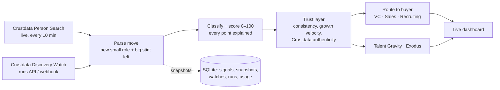

# Riptide: live talent-flow signals on Crustdata

> **One line:** Riptide tells you the moment someone leaves a big company for a startup, says who should act on it and why, and checks that the profile behind the signal is real.

**Theme:** Revenue (and Infrastructure for agents), ContextCon 04, IIT Kanpur. Built on Crustdata's Person Search, Discovery Watchers, Person Enrich and the authenticity assessment.

```
Crustdata Person Search + a live Discovery Watcher
      │   "worked at Google / Microsoft / Amazon / Flipkart / … ,
      │    started a new role in the last 60 days, at a company of ≤ 50 people"
      ▼
673 people in India right now  →  parsed into moves  →  scored 0–100  →  trust-checked  →  routed to a buyer
      ▼
"Founder leap: ex-Zomato APAC lead → Founder & CEO @ TRIBE (score 68, trusted)"
   VC:    founder left Zomato to build TRIBE — add to deal flow, intro before the round
   Sales: new company buying its first tools — offer a founder plan
```

---

## The service it replaces

Three kinds of firms pay people to watch who moves where:

| Buyer | What they pay for today | What Riptide gives them |
|---|---|---|
| **VC funds and scouts** | Analysts and tools like Specter or Harmonic, looking for founders before they raise | Founder leaps and stealth founders the week they happen, scored by where the person came from |
| **Sales teams** | "Job-change" and intent tools (UserGems-style), or SDRs reading LinkedIn by hand | A new VP or Head at a startup: a fresh budget owner in their first 90 days |
| **Recruiters** | Sourcers tracking which companies are leaking talent | Which big companies people are leaving, and which startups they're joining |

It's the same raw event, a person changing jobs, sold three times. The value is getting it early and trusting it.

## What it does, end to end

1. **Finds the moves live.** A Crustdata Person Search asks for people whose *past* employer is a big company and whose *current* role started in the last 60 days at a company of 50 or fewer, in India. Each scan reads it fresh, with no cache. The server rescans every 10 minutes.
2. **Saves it as a real Crustdata watcher.** One click saves the same filter as a **Discovery Watch** (live during the build: watch #56497). Its runs deliver the people who newly match. Riptide reads them from the run API (pull-only), or receives them at `POST /webhooks/crustdata` if you give it a public URL.
3. **Turns each profile into a move.** It finds the newest small-company role and the big-company stint the person left. Internships, fellowships, universities, hospitals, freelancing and "independent consultant" don't count as moves.
4. **Classifies and scores it (0–100), with every point explained:** how prestigious the old employer was, seniority there, tenure, where they went (stealth or founder ranks highest), how fresh the move is, and whether the big company was their last job.
   - Stealth founder · Founder leap · Senior startup hire · Startup hire
5. **Routes it to a buyer with a next step** (VC, Sales, Recruiting). These are drafts only. Nobody is contacted, per the handbook.
6. **Checks the profile is real before anyone acts on it.** See *Trust layer* below. A profile flagged for review has its score halved and is kept out of every index.
7. **Aggregates:**
   - **Talent Gravity** ranks startups by how much senior big-company talent they are pulling. Talent inflow is a leading indicator of a raise.
   - **Exodus** ranks big companies by how many people they are losing.

### Trust layer: is the profile behind the signal real?

Fake and inflated profiles pollute every signal product. Riptide checks each one, from data Crustdata already returned, so the checks cost nothing extra:

| Check | What it catches |
|---|---|
| Verified business email on a role | A strong sign the employment is real |
| Employer linked to a real company page | An invented "Vice President at Google" usually isn't linked to Google's page |
| Network fits the claim | A "Director" with 40 connections |
| Audience shape | 9,000 followers on 40 connections, a bought-audience pattern |
| Concurrent roles | More than three full-time jobs at once |
| **Growth velocity** | Every scan stores a snapshot of connections and followers. A sudden spike between snapshots is flagged. |
| **Crustdata's own verdict** (on demand) | Person Enrich `assessment.authenticity`: clearly genuine through clearly fabricated, tier 0–9. It costs no extra credits. |

Verdicts are *trusted · ok · unconfirmed · needs review*. They're flags for a person to read, never accusations. Crustdata's own docs say the same about `probably_fabricated`.

**What we could not measure:** LinkedIn's daily profile views are not exposed by any Crustdata endpoint, and we don't scrape LinkedIn. Growth velocity across our own snapshots is the honest substitute.

## How it makes Crustdata more money

Riptide sells outcomes, not API calls, and every outcome is metered Crustdata usage:

| Step | Crustdata endpoint | Credits |
|---|---|---|
| Find the moves | Person Search | about 0.03 per result read (our live scans: 2.25 credits for 75 results, 43 signals) |
| Keep it live | Discovery Watcher | 0.5 per person delivered after a free baseline. Every customer adds watchers. |
| Trust it | Person Enrich (`assessment`) and Batch Person Verification | about 1 per enrich, 10 per verification verdict |

- **Three buyers, one event.** The same move is a deal-flow lead, a sales trigger and a recruiting signal, so Crustdata sells one data pull three times as packaged feeds.
- **From API to subscription.** VCs and sales teams don't want to write filters. They buy "founders leaving FAANG this week" as a feed. That moves Crustdata from developer usage to seat or per-signal pricing, competing with tools that charge thousands of dollars a year.
- **Trust as an upsell.** Every delivered signal can carry an authenticity verdict, a paid add-on no other signal vendor has.
- **A dataset of its own.** Talent Gravity and Exodus, computed across all customers' watches, become a premium index: which startups are pulling talent, before they announce a round.

## How to run it

Python 3.10+, standard library only.

```bash
echo 'CRUSTDATA_API_KEY=cd_...' > .env          # gitignored
python3 riptide.py serve                         # http://localhost:8100 — live dashboard, rescans every 10 min
python3 riptide.py scan                          # one live scan, printed
python3 riptide.py watch [--webhook https://…]   # save the filter as a Crustdata Discovery Watch
python3 riptide.py poll                          # read new watcher runs
python3 -m unittest discover -s tests -v         # 33 tests (8 Riptide, 25 Bazaar)
```

`RIPTIDE_SCAN_MINUTES`, `RIPTIDE_SINCE_DAYS` and `RIPTIDE_COUNTRY` change the schedule and the filter.

**Dashboard:** a live feed (new signals flash), tabs per buyer (VC deal flow, Sales triggers, Recruiting, Trust: needs review), "why this score" and trust checks on every card, a **Deep check** button for Crustdata's authenticity verdict, Talent Gravity, Exodus, an activity log, and credits spent per signal.

## How it's built



- [riptide/engine.py](riptide/engine.py) holds the filter, move parsing, scoring, trust checks, watcher create and poll, webhook ingest, deep check and aggregates.
- [riptide/server.py](riptide/server.py) runs the background live loop and the JSON API. [web/riptide.html](web/riptide.html) is the dashboard.
- One move is one signal (keyed on person, new company and start date), so a rescan or a repeated watcher run never duplicates it. Watcher runs already read are recorded and never ingested twice.
- The shared Crustdata client retries 429 and 5xx with `x-ratelimit-reset`, never retries 401/402/403, and works on python.org macOS builds that ship without root certificates.

## Approaches we weighed

1. **Scrape LinkedIn for views and connections.** It breaks LinkedIn's terms, and the data would be the opposite of what Crustdata sells. Rejected.
2. **Only Crustdata Watchers with webhooks.** This is the right production design, but it needs a public URL, and a new watch's later runs are hourly at best. We use the watcher for the "keep it live" path and a live Person Search for instant results.
3. **Chosen: search plus watcher plus our own snapshots.** It is instant on first open and stays live, and the snapshots give growth velocity, which no single call provides.

**What didn't work at first:**
- The raw search matched people through *any* past role. An internship at Microsoft or a fellowship at Google made someone a "big-company leaver", and universities and hospitals counted as big companies. Move parsing now requires a real stint and a real company.
- Watcher runs nest delivered people under `notifications[].payload.notifications[].record`. Our first reader found 0 of the 5 people the watcher actually delivered.

## What we left out, and what's next

- **Webhooks in production:** run behind a public URL so watchers push instead of being polled.
- **Person Entity Watchers on the people already in the feed,** so a founder's later title change ("Co-founder" to "CEO, raised seed") is a second signal.
- **Calibrate the score** against moves that were followed by a funding round. Talent Gravity's predictive claim needs that back-test before anyone sells it.
- **Outreach:** drafts only tonight. Sending needs consent and a sender identity.

---

*Earlier tonight we built Bazaar, an AI procurement department. It is still in this repo and still works (`python3 run.py serve`). See [BAZAAR.md](BAZAAR.md).*
